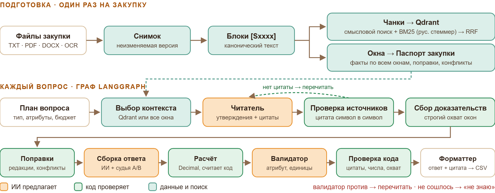
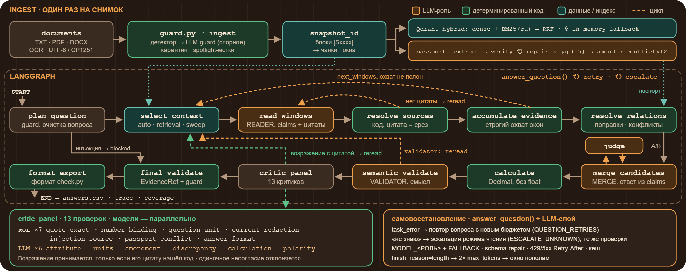

# Липецкие котики — ИИ, который не обманывает

Ассистент для анализа документов закупок. Он отвечает на вопросы по извещению, требованиям к заявке, описанию
объекта и проекту контракта. Каждый ответ подтверждается дословной цитатой из документа, а если подтверждения
нет — ассистент честно говорит «не знаю».

**Знает — докажет. Не знает — честно скажет.**

Языковая модель здесь только предлагает: выписывает утверждения с цитатами, собирает ответ, высказывает
возражения. Принимает ответ код: он находит цитату в документе символ в символ, сверяет числа и даты,
проверяет действующую редакцию с учётом изменений извещения и сам считает арифметику. Отвечать «нет в
документах» можно только после чтения всех файлов закупки. Если две действующие редакции расходятся, выбрать
одну сторону нельзя — пользователь увидит обе.

## Что реализовано

- **Четыре честных статуса ответа**: «ответ», «расхождение», «нет в документах», «не знаю». У каждого ответа
  есть цитата, файл и точное место в документе.
- **Паспорт закупки.** Перед вопросами система читает все документы и составляет паспорт: факты, изменения
  извещения и противоречия между документами. Отклонённые кодом факты уходят модели на исправление. Важные
  атрибуты (НМЦК, обеспечения, сроки, гарантия, опыт, лицензии и другие) добираются по чек-листу, даже если
  документ называет их иначе.
- **Гибридный поиск.** Qdrant ищет одновременно по смыслу (эмбеддинги) и по словам (BM25 с русским стеммером),
  результаты объединяются через RRF. Небольшие закупки читаются целиком, большие — через поиск. Если нужно
  доказать отсутствие сведений, система сплошь прочитывает весь комплект порциями.
- **Граф проверок на LangGraph.** У каждого шага своя роль: чтение, проверка источников, учёт изменений, сборка
  ответа, судья неоднозначностей, расчёт на Decimal, смысловой валидатор, проверка отсутствия.
- **Панель из 13 критиков**: 7 работают кодом, 6 — моделью, параллельно. Возражение критика учитывается только
  тогда, когда он приводит цитату и код находит её в документе.
- **Защита от промпт-инъекций.** Отдельный компонент находит в документах и в вопросе команды, адресованные ИИ,
  невидимые символы и подделку границ документа. Найденные фрагменты попадают в карантин ещё до показа модели.
- **Самовосстановление**:
  - если модель не ответила по схеме, система исправляет формат, а затем переключается на запасную модель;
  - при технической ошибке вопрос повторяется;
  - если вышло «не знаю», делается вторая попытка другим способом чтения;
  - если Qdrant недоступен, работает локальный гибридный индекс.
- **Своя модель для каждого компонента.** Модель задаётся в `.env` отдельно для паспорта, читателя,
  валидатора, каждого из критиков и других ролей.
- **Сайт.** Загрузка документов, диалог с уточняющими вопросами, пакет вопросов из CSV, сравнение «было /
  стало», журнал проверок по каждому ответу и голосовой ввод. Речь распознаётся локально моделью GigaAM, аудио
  никуда не отправляется.
- **Форматы файлов**: TXT в UTF-8 и CP1251, PDF с текстовым слоем, DOCX. Сканы распознаются через OCR (Tesseract,
  необязательно). Пустые и нечитаемые файлы не пропускаются молча — они отмечены в интерфейсе.

## Установка и запуск

Нужно: ключ [OpenRouter](https://openrouter.ai/keys), Python 3.10–3.13 (рекомендуется 3.12) и ffmpeg для
голосового ввода. Docker нужен для Qdrant; без него поиск работает в памяти процесса. Видеокарта не нужна.

### Windows 10/11

Откройте PowerShell и установите программы:

```powershell
winget install -e --id Python.Python.3.12
winget install -e --id Gyan.FFmpeg
winget install -e --id Docker.DockerDesktop
```

Закройте PowerShell, запустите Docker Desktop и откройте **новое** окно PowerShell: PATH обновляется только в новых
окнах. Распакуйте архив и выполните команды из папки проекта (путь замените на свой):

```powershell
cd $HOME\Downloads\lipetskie-kotiki
py -3.12 -m venv .venv
.\.venv\Scripts\python.exe -m pip install --upgrade pip
.\.venv\Scripts\python.exe -m pip install -r requirements.txt
.\.venv\Scripts\python.exe -m pip uninstall -y gigaam
.\.venv\Scripts\python.exe -m pip install --upgrade -r requirements-voice.txt
Copy-Item .env.example .env
notepad .env
```

В блокноте впишите ключ после `OPENROUTER_API_KEY=`, сохраните файл и закройте блокнот. Затем:

```powershell
docker compose up -d qdrant
.\.venv\Scripts\python.exe app.py
```

Откройте в браузере http://localhost:8000.

Для следующих запусков достаточно двух последних команд. Можно и проще — дважды щёлкнуть `run.bat`: он сам
поставит зависимости, создаст `.env`, поднимет Qdrant и откроет браузер. Голосовой ввод так же ставит
`install_voice.bat`.

### Ubuntu 22.04 / 24.04

```bash
sudo apt update
sudo apt install -y python3 python3-venv python3-pip ffmpeg docker.io docker-compose-v2
cd ~/Downloads/lipetskie-kotiki
python3 -m venv .venv
.venv/bin/python -m pip install --upgrade pip
.venv/bin/python -m pip install -r requirements.txt
.venv/bin/python -m pip install --upgrade -r requirements-voice.txt
cp .env.example .env
nano .env
```

Впишите ключ после `OPENROUTER_API_KEY=`, сохраните (Ctrl+O, Enter) и выйдите (Ctrl+X). Затем:

```bash
sudo docker compose up -d qdrant
.venv/bin/python app.py
```

Откройте http://localhost:8000. Для следующих запусков подойдёт `sh run.sh`.

### Пояснения к установке

- **Голосовой ввод.** `requirements-voice.txt` ставит CPU-сборки torch и torchaudio и пакет GigaAM из
  репозитория GitHub. Пакет `gigaam` с PyPI (0.1.0) не подходит: в нём нет моделей v3, поэтому на Windows он
  сначала удаляется. Веса модели скачиваются при первом нажатии на микрофон в `~/.cache/gigaam`.
  Одна запись — до 25 секунд. Без этих пакетов сайт работает, кнопка микрофона просто сообщит, что модуль не
  установлен.
- **Qdrant** работает в Docker на `localhost:6333`, индекс хранится в томе `qdrant_storage` и переживает
  перезапуск. Если Docker не запущен, при подготовке появится предупреждение, а поиск пойдёт по локальному
  индексу в памяти. Алгоритм тот же — dense + BM25 + RRF.
- **OCR сканов** (необязательно): Python-пакет уже входит в `requirements.txt`, нужна ещё программа Tesseract
  с русским языком:
  - Windows: `winget install -e --id UB-Mannheim.TesseractOCR`, путь к `tesseract.exe` — в `TESSERACT_CMD`;
  - Ubuntu: `sudo apt install -y tesseract-ocr tesseract-ocr-rus`.

## Как пользоваться

1. На стартовом экране загрузите файлы закупки. Одна папка — одна закупка; можно загрузить сразу несколько
   закупок. Система подготовит снимок, паспорт и поисковый индекс и покажет найденные изменения извещения и
   противоречия между документами.
2. **Диалог** — задавайте вопросы текстом или голосом. Уточняющие вопросы («а в рублях?») понимаются с учётом
   предыдущих. У каждого ответа — статус, цитата, файл и раскрываемый журнал проверок.
3. **Вопросы из CSV** — пакет вопросов в формате `id;package;question`. Результат скачивается в формате
   `id;status;answer;quote;file`; рядом можно включить вариант «было» (один запрос к модели) для сравнения.
4. **Проверка** — если есть эталонные ответы, загрузите их, и неизменённый `tools/check.py` посчитает верные
   ответы, осторожные «не знаю» и обманы.

Без браузера (из папки проекта; на Windows вместо `.venv/bin/python` — `.\.venv\Scripts\python.exe`):

```bash
.venv/bin/python cli.py --packages путь/к/закупкам --questions questions.csv
.venv/bin/python cli.py --packages путь/к/закупкам --questions questions.csv --baseline --gold answers.json
```

Все результаты прогона лежат в `data/runs/<id>/`:
- `answers.csv` — ответы;
- `trace.json` и `journal/` — журнал узлов графа по каждому вопросу;
- `coverage.json` — что прочитано;
- `calculations.json` — расчёты;
- `run_config.json` — модели и настройки каждой роли;
- `prompts.json` — промпты.

## Архитектура



**Подготовка — один раз на закупку.** Файлы превращаются в неизменяемый снимок: его идентификатор — хеш
содержимого и версий обработки. Текст режется на блоки с номерами источников `[Sxxxx]`. Цитата всегда задаётся
диапазоном в каноническом тексте, поэтому код может проверить её буквально. Из блоков собираются чанки для
поиска в Qdrant и окна для паспорта закупки.

**Каждый вопрос — граф LangGraph.**
1. План определяет тип вопроса и бюджет.
2. Выбор контекста решает, читать закупку целиком или через поиск.
3. Читатель выписывает утверждения с дословными цитатами. Код ищет каждую цитату в документе: если не нашёл,
   окно перечитывается с замечанием.
4. Строгий охват гарантирует, что для «нет в документах» прочитано всё.
5. Учитываются изменения и противоречия, собирается ответ (при неоднозначности — с судьёй), код делает расчёт.
6. Смысловой валидатор проверяет, тот ли это атрибут и те ли единицы.
7. Финальная проверка кодом решает судьбу ответа.

Оранжевое на схеме — предлагает модель, зелёное — проверяет код.



**Харнесс** — тот же конвейер на уровне узлов. На подготовке документы проходят защиту от инъекций: детектор
кодом, модель-классификатор для спорных случаев, карантин и метки границ данных. Затем строятся гибридный
индекс и паспорт: извлечение фактов, проверка кодом, цикл исправления, чек-лист, разбор изменений, сверка
противоречий.

В графе 13 узлов и ограниченные циклы:
- код не нашёл цитату — перечитать окно;
- охват неполон — следующие окна;
- валидатор или критик с подтверждённой цитатой возражает — перечитать с замечанием;
- вопрос оказался инъекцией — сразу на финальную проверку.

Снизу на схеме — панель критиков и самовосстановление.

### Критики

| Критик | Чем работает | Что проверяет |
|---|---|---|
| `quote_exact` | код | цитата буквально равна фрагменту документа |
| `number_binding` | код | числа ответа взяты из подтверждённых утверждений |
| `question_unit` | код | единица ответа совпадает с единицей вопроса (рубли, проценты, дни, месяцы) |
| `current_redaction` | код | ответ не опирается на редакцию, отменённую изменением |
| `injection_source` | код | ни одно доказательство не взято из фрагмента в карантине |
| `passport_conflict` | код | в паспорте нет подтверждённого другого значения того же атрибута |
| `answer_format` | код | «да/нет», дата и время, числа цифрами |
| `attribute` | модель | тот ли атрибут и объект (обеспечение заявки или исполнения, НМЦК или цена опыта) |
| `units` | модель | рабочие или календарные дни, «не менее / не более», проценты или рубли |
| `amendment` | модель | значение не изменено файлом изменений извещения |
| `discrepancy` | модель | «адвокат дьявола»: ищет то же требование с другим значением в другом документе |
| `calculation` | модель | правильны ли база и ставка расчёта |
| `polarity` | модель | «установлено» или «не установлено», «допускается» или «не допускается» |

Критики-модели запускаются только там, где применимы. Возражение без цитаты, которую нашёл код, ответ не
блокирует. Если один критик стоит на своём против согласных валидатора и остальных критиков, его возражение
отклоняется и записывается в журнал. Исключение — расхождения, изменения и расчёт: там пропуск ведёт к обману,
поэтому такое возражение блокирует ответ и после перечитывания.

### Самовосстановление

| Ситуация | Реакция |
|---|---|
| сеть, 429, 5xx | повторы с учётом `Retry-After` |
| ответ модели не по схеме | одно исправление формата, затем запасная модель роли |
| ответ обрезан по длине | удвоенный лимит, затем окно делится пополам |
| основная модель роли недоступна | `FALLBACK_MODEL_<РОЛЬ>` или `OPENROUTER_FALLBACK_MODEL` |
| техническая ошибка вопроса | вопрос повторяется с новым бюджетом |
| «не знаю» из-за неполной проверки | вторая попытка другим способом чтения с теми же проверками |
| валидатор подтвердил ответ, но отметил лишнее утверждение | лишнее отсекается, ответ принимается |
| большой комплект не помещается в бюджет вызовов | сплошное чтение порциями с полным охватом |
| Qdrant недоступен | локальный гибридный индекс в памяти |
| окно паспорта не прочитано | повтор окна при подготовке |

## Компоненты и файлы

| Файл | За что отвечает |
|---|---|
| `app.py` | запуск сайта |
| `cli.py` | пакетная обработка вопросов из CSV без браузера |
| `run.bat`, `run.sh` | запуск в одну команду: зависимости, `.env`, Qdrant, сайт |
| `install_voice.bat` | установка голосового ввода на Windows |
| `docker-compose.yml` | Qdrant Server |
| `opora/config.py` | настройки из `.env`, модели и лимиты по компонентам |
| `opora/documents.py` | чтение TXT/PDF/DOCX, кодировки, OCR, пустые файлы |
| `opora/sources.py` | снимок, блоки, окна, строгое разрешение цитат, показ текста модели |
| `opora/guard.py` | защита от промпт-инъекций |
| `opora/amendments.py` | разбор изменений извещения кодом |
| `opora/knowledge.py` | паспорт закупки: факты, исправление, чек-лист, изменения, противоречия |
| `opora/retrieval.py` | гибридный поиск: Qdrant и локальный индекс |
| `opora/graph.py` | граф вопроса на LangGraph и самовосстановление |
| `opora/critics.py` | панель критиков |
| `opora/validators.py` | проверки утверждений и итога кодом |
| `opora/coverage.py` | журнал охвата и правило «нет в документах» |
| `opora/calculator.py` | расчёты на Decimal |
| `opora/quotes.py`, `opora/textnorm.py` | цитаты и нормализация текста, совместимая с форматом проверки |
| `opora/formatter.py` | формат ответа: да/нет, даты, числа, расхождения |
| `opora/prompts.py` | промпты и JSON-схемы ролей |
| `opora/schemas.py` | типы данных и проверка JSON-ответов модели |
| `opora/llm.py` | клиент OpenRouter: модели ролей, запасная модель, кеш, учёт вызовов |
| `opora/pipeline.py` | точки входа «было» и «стало» |
| `opora/store.py` | снимки, подготовка, прогоны, диалоги на диске |
| `opora/evaluate.py` | оценка эталоном через неизменённый `tools/check.py` |
| `opora/server.py` | HTTP API и раздача интерфейса |
| `opora/voice.py` | распознавание речи GigaAM |
| `web/` | интерфейс: HTML, CSS, JS без сборки |
| `tools/check.py` | официальный формат проверки ответов (используется вкладкой «Проверка») |
| `tools/check_voice.py` | пробный запуск GigaAM при установке голосового ввода |

## Настройки

Все параметры перечислены в `.env.example` с комментариями. Главное:

- `OPENROUTER_API_KEY` — ключ OpenRouter, единственное обязательное поле.
- `OPENROUTER_MODEL` — модель по умолчанию, `OPENROUTER_EMBEDDING_MODEL` — модель эмбеддингов.
- `MODEL_<КОМПОНЕНТ>` — своя модель для компонента: `MODEL_READER`, `MODEL_VALIDATOR`, `MODEL_CRITIC_DISCREPANCY`
  и другие. Аналогично задаются `FALLBACK_MODEL_*`, `PROVIDER_*`, `MAX_TOKENS_*`, `REASONING_*`.
- `READ_MODE` — способ чтения: `auto`, `full_context`, `retrieval`, `exhaustive`.
- `CRITICS` — набор критиков: `all`, `none` или список через запятую.
- `GUARD_LLM`, `QUESTION_RETRIES`, `ESCALATE_UNKNOWN`, `PASSPORT_REPAIR`, `PASSPORT_CHECKLIST` — защита,
  самовосстановление и усиление паспорта.
- `MAX_LLM_CALLS_PER_QUESTION`, `QUESTION_DEADLINE_SECONDS` — бюджет одного вопроса.

Повторные одинаковые запросы к модели берутся из дискового кеша (`data/cache`), поэтому повторная обработка тех
же документов почти ничего не стоит.
